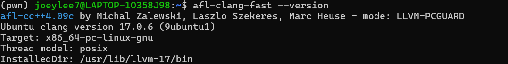
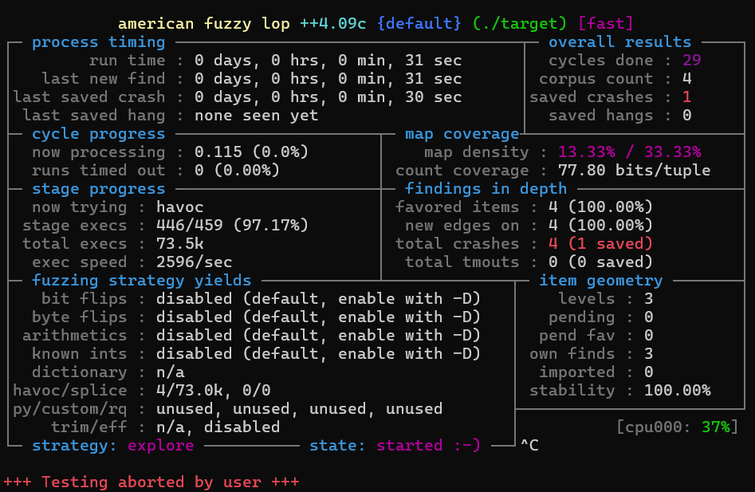
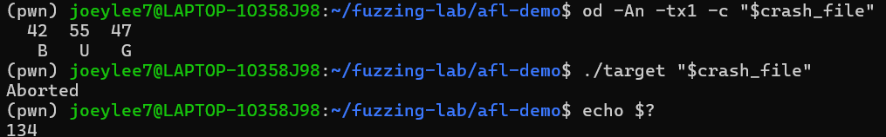

이번 공부는 퍼징이 무엇인지 배우고 여러 퍼저의 차이를 정리하는 것이다. 이 글에서는 먼저 퍼징을 이해하는 데 필요한 개념을 설명하고 AFL++로 작은 C 프로그램의 크래시 입력을 찾은 과정을 기록한다. libFuzzer와 Jackalope는 공식 문서를 바탕으로 비교했으며 직접 실행한 도구는 AFL++다.

이번 실습은 특정 입력에서 의도적으로 비정상 종료되는 교육용 예제를 사용했다. 실제 프로그램의 새로운 취약점을 발견한 실습은 아니다.

## 퍼징은 무엇을 하는가

프로그램에 파일이나 문자열을 전달하면 프로그램은 그 내용을 검사하고 처리한다. 개발자는 보통 정상적인 입력을 예상해서 코드를 작성하지만 너무 짧거나 형식이 잘못된 입력에서는 예상하지 못한 동작이 생길 수 있다.

퍼징(fuzzing)은 다양한 입력을 자동으로 만들어 프로그램에 반복해서 전달하고 크래시나 오류 같은 이상 동작을 찾는 테스트 방법이다. 이 작업을 수행하는 도구가 퍼저(fuzzer)다.

예를 들어 파일을 읽는 프로그램을 검사한다면 사람이 파일 내용을 매번 고쳐 실행하는 대신 퍼저가 바이트를 바꾸고 실행 결과를 관찰한다. 다만 입력을 많이 넣었다고 모든 버그를 찾았다는 뜻은 아니다. 어떤 코드를 실행했는지, 오류를 감지할 수단이 있는지, 검사할 기능에 입력이 실제로 도달하는지가 결과에 영향을 준다.

## 퍼징의 종류는 분류 기준부터 구분하기

입력을 만드는 방식과 프로그램 내부를 관찰하는 정도는 서로 다른 기준이다. 따라서 하나의 퍼저를 mutation-based이면서 grey-box라고 설명할 수 있다.

| 분류 기준 | 종류 | 의미 |
|---|---|---|
| 입력 생성 방식 | Mutation-based | 기존 입력의 일부를 바꾸거나 추가·삭제해서 새 입력을 만든다. |
| 입력 생성 방식 | Generation-based | 파일 형식이나 문법 같은 규칙을 이용해 입력을 만든다. |
| 내부 관찰 정도 | Black-box | 내부 실행 정보 없이 외부에서 관찰되는 결과를 이용한다. |
| 내부 관찰 정도 | Grey-box | 커버리지 등 제한된 내부 정보를 이용해 탐색한다. |
| 내부 관찰 정도 | White-box | 코드와 경로 조건을 상세히 분석해 입력 생성에 활용한다. 심볼릭 실행이 대표적인 접근 중 하나다. |

이 구분은 이해를 돕는 기준이며 실제 도구는 여러 방식을 결합할 수 있다. 소스코드가 있다는 이유만으로 white-box가 되는 것도 아니다. 이번 실습에서는 소스코드를 사용했지만 주로 실행 경로 정보를 활용하는 coverage-guided grey-box 퍼징을 진행했다.

## 실행 경로를 보고 입력을 고른다는 뜻

Coverage-guided fuzzing은 입력을 실행한 뒤 얻은 커버리지 정보를 다음 탐색에 활용한다. 새로운 코드 영역이나 분기 사이의 연결 등을 관찰하게 만든 입력은 이후 변이의 재료로 보관할 수 있다. 구체적으로 무엇을 새 커버리지로 판단하는지는 도구와 설정에 따라 다르다.

이번 예제는 입력의 첫 글자가 `B`인지 검사한 뒤 다음 글자가 `U`인지, 세 번째 글자가 `G`인지 순서대로 검사한다. `AAA`와 `BAA`는 도달하는 코드가 다르다. 퍼저는 이런 차이를 관찰하면서 탐색을 이어간다. 다만 실제로 `AAA → BAA → BUA → BUG` 순서로 입력이 만들어졌다고 확인한 것은 아니다. 이는 분기와 커버리지의 관계를 설명하기 위한 예다.

새로운 경로를 실행했다고 곧바로 오류가 발견되는 것은 아니다. 정상 경로도 새 커버리지를 만들 수 있다. 탐색을 진전시키는 입력과 실제 크래시를 일으키는 입력은 구분해서 봐야 한다.

## 실습 전에 알아둘 용어

| 용어 | 이번 실습에 연결해서 이해하기 |
|---|---|
| Seed | 탐색을 시작할 입력. 이번에는 `AAA`를 담은 파일을 사용했다. |
| Corpus | 퍼징에 사용할 입력들의 모음. 처음의 seed 모음과 탐색 중 보관한 입력들을 생각하면 된다. |
| Fuzz target | 검사할 프로그램 또는 함수. 이번에는 `target` 실행 파일이다. |
| Harness | 퍼저의 입력을 검사할 기능에 전달하는 연결 코드. 이번 예제의 `main`은 파일을 읽고 조건 검사 코드에 전달한다. |
| Instrumentation, 계측 | 실행 중 어떤 코드가 실행됐는지 등을 관찰하도록 코드를 추가하는 작업이다. |
| Sanitizer | 메모리 접근 오류나 정의되지 않은 동작 등을 감지하는 도구. 이번 예제에서는 사용하지 않았다. |

C로 작성한 `target.c`는 사람이 읽고 수정할 수 있는 소스코드다. 컴파일러는 이를 컴퓨터가 실행할 수 있는 형태로 바꾼다. 그 결과가 이번 실습의 실행 파일 `target`이다. 일반적으로 바이너리 대상이라고 할 때는 이렇게 컴파일된 프로그램을 가리킨다.

## AFL++·libFuzzer·Jackalope 비교

세 도구는 모두 실행 중 얻은 커버리지 정보를 탐색에 활용할 수 있지만 입력을 검사할 기능과 연결하는 방식이 다르다.

| 도구 | 대표적인 사용 방식 | 준비할 것 |
|---|---|---|
| AFL++ | 계측한 실행 파일에 입력을 전달하고 변이·실행을 반복한다. | 이번 방식에서는 소스코드를 전용 컴파일러로 빌드한다. 소스코드가 없는 대상을 위한 별도 모드도 있다. |
| libFuzzer | 하나의 프로세스 안에서 `LLVMFuzzerTestOneInput` 함수를 반복 호출한다. | 입력 바이트와 길이를 받아 검사할 함수로 전달하는 harness, 계측 및 libFuzzer 런타임을 포함한 빌드가 필요하다. |
| Jackalope | 컴파일된 바이너리를 동적으로 계측하며 입력을 탐색한다. | 바이너리의 실행 방식과 입력 전달 방식을 설정한다. TinyInst를 활용하며 대상에 맞춘 연결 코드가 필요할 수 있다. |

AFL++의 파일 입력 방식에서는 실행 명령과 입력 파일의 관계를 살펴볼 수 있다. libFuzzer는 라이브러리 내부의 특정 함수에 입력을 바로 전달하는 구조를 이해할 때 참고할 수 있다. Jackalope는 소스코드 없이 바이너리를 검사하는 접근을 비교하는 데 도움이 된다. 여기서 AFL++는 파일만 검사할 수 있다거나 반드시 소스코드가 있어야 한다는 뜻은 아니다.

## 실습 환경과 설치

| 항목 | 확인한 값 |
|---|---|
| 운영체제 | WSL의 Ubuntu 24.04.4 LTS |
| CPU 아키텍처 | `x86_64` |
| AFL++ | `4.09c` |
| Clang | `17.0.6` |
| 계측 모드 | `LLVM-PCGUARD` |

환경은 아래 명령으로 확인했다.

```bash
cat /etc/os-release
uname -m
```

처음에는 `gcc`, `make`, `git`이 있었고 `clang`, `afl-fuzz`, `afl-clang-fast`는 찾을 수 없었다. 설치에는 다음 명령을 사용했다.

```bash
sudo apt update
sudo apt install afl++ clang
```

`apt update`는 패키지 목록을 갱신하고 `apt install`은 지정한 패키지를 설치한다. 설치 후 다음 명령으로 도구 위치와 컴파일러 버전을 확인했다.

```bash
command -v afl-fuzz
command -v afl-clang-fast
afl-clang-fast --version
```

각각 `/usr/bin/afl-fuzz`, `/usr/bin/afl-clang-fast`가 출력됐고 버전 출력에서 위 표의 값을 확인했다. 이 값은 이번에 사용한 버전이며 최신 버전이라는 뜻은 아니다.



## 작은 교육용 프로그램 만들기

실습 폴더를 만들고 이동했다.

```bash
mkdir -p ~/fuzzing-lab/afl-demo
cd ~/fuzzing-lab/afl-demo
```

아래 코드를 `target.c`로 저장했다.

```c
#include <stdio.h>
#include <stdlib.h>

int main(int argc, char *argv[]) {
    unsigned char buf[4];
    size_t len;

    if (argc != 2) {
        fprintf(stderr, "Usage: %s INPUT_FILE\n", argv[0]);
        return 1;
    }

    FILE *fp = fopen(argv[1], "rb");
    if (fp == NULL) {
        perror("fopen");
        return 1;
    }

    len = fread(buf, 1, sizeof(buf), fp);
    fclose(fp);

    if (len >= 3) {
        if (buf[0] == 'B') {
            if (buf[1] == 'U') {
                if (buf[2] == 'G') {
                    abort();
                }
            }
        }
    }

    return 0;
}
```

`argc`는 프로그램에 전달된 인자의 개수이며 실행 명령 자체도 포함한다. `argv[1]`은 실행 명령 뒤에 전달한 입력 파일 경로다. 파일을 열고 최대 4바이트를 읽은 뒤 실제 읽은 길이가 3바이트 이상일 때만 첫 세 바이트를 검사한다. C 배열의 첫 번째 원소 번호는 0이므로 `buf[0]`이 첫 글자다.

입력이 `BUG`로 시작하면 `abort()`를 호출한다. `abort()`는 프로그램을 비정상 종료시키는 함수다. 길이를 확인하고 읽기 때문에 이 코드는 버퍼 오버플로를 의도한 예제가 아니다. 목표는 퍼저가 조건을 만족하는 입력을 찾아내는 과정을 확인하는 것이다.

다음 명령으로 컴파일했다.

```bash
afl-clang-fast -g -O0 target.c -o target
```

`-g`는 디버깅 정보를 포함하고 `-O0`는 컴파일러 최적화를 끈다. `-o target`은 출력 실행 파일의 이름을 지정한다. `afl-clang-fast`를 사용하면 실행 경로를 관찰할 계측도 추가된다.

## Seed 준비와 퍼징 실행

시작 입력으로 줄바꿈 없는 `AAA` 파일을 만들었다.

```bash
mkdir -p seeds
printf 'AAA' > seeds/seed.txt
```

직접 실행하는 방법은 다음과 같다. 정상 입력이면 종료 상태 `0`이 예상된다.

```bash
./target seeds/seed.txt
echo $?
```

`./target`은 현재 폴더의 실행 파일을 실행한다는 뜻이다. `$?`에는 직전 명령의 종료 상태가 들어가므로 실행 직후 확인해야 한다.

퍼징 실행 명령은 다음과 같다.

```bash
afl-fuzz -i seeds -o findings -- ./target @@
```

`-i`는 시작 입력 폴더, `-o`는 결과 폴더를 지정한다. `--` 뒤는 검사할 프로그램의 실행 명령이다. `@@`는 AFL++가 만드는 테스트 입력 파일 경로로 바뀐다. 이 예제는 파일 경로를 인자로 받기 때문에 이 방식을 사용했다.

## WSL에서 만난 core_pattern 오류

첫 실행은 아래 오류로 중단됐다.

```text
PROGRAM ABORT : Pipe at the beginning of 'core_pattern'
```

이번 환경의 `core_pattern`은 크래시 처리를 별도 도구로 넘기도록 설정돼 있었다. AFL++는 그 과정의 지연 때문에 크래시가 시간 초과로 잘못 처리될 수 있다고 경고했다. 예제 자체의 오류가 아니라 퍼저가 검사 시작 전에 확인한 환경 설정 문제였다.

원래 값을 먼저 확인하고 저장했다. 아래 명령은 저장 파일이 이미 있으면 덮어쓰지 않는다.

```bash
cat /proc/sys/kernel/core_pattern
test -f core_pattern.before.txt || cat /proc/sys/kernel/core_pattern > core_pattern.before.txt
```

이후 현재 Ubuntu 환경에 적용되는 설정을 임시로 바꿨다.

```bash
printf 'core\n' | sudo tee /proc/sys/kernel/core_pattern
```

`sudo tee`는 관리자 권한으로 값을 쓴다. 이 변경은 해당 Ubuntu 환경의 다른 프로세스에도 영향을 주므로 실습을 마친 뒤 복원했다. 모든 환경에서 필요한 절차는 아니며 여기서는 실제 발생한 오류에 대응하기 위해 사용했다.

같은 퍼징 명령을 다시 실행하자 상태 화면에서 `saved crashes : 1`을 확인했다. 이후 `Ctrl + C`로 중지했다.



## 저장된 입력으로 크래시 재현하기

이번 단일 실행의 결과는 `findings/default` 아래에 저장됐다. 크래시 입력은 다음 명령으로 찾았다.

```bash
find findings/default/crashes -type f -name 'id:*'
```

출력된 파일명은 다음과 같았다.

```text
id:000000,sig:06,src:000003,time:1238,execs:3064,op:havoc,rep:2
```

이 파일명은 이번 실행에서 나온 기록이다. 다른 실행에서도 같은 이름이나 같은 시간이 나온다는 뜻은 아니다.

파일 경로를 변수에 담고 내용을 확인했다.

```bash
crash_file=$(find findings/default/crashes -type f -name 'id:*' -print -quit)
od -An -tx1 -c "$crash_file"
```

실제 출력은 다음과 같았다.

```text
 42 55 47
  B  U  G
```

`42 55 47`은 16진수로 표시한 바이트 값이며 문자 `B`, `U`, `G`에 대응한다. 시작 입력은 `AAA`였는데 저장된 크래시 파일에는 `BUG`가 들어 있었다.

퍼저를 거치지 않고 이 파일을 프로그램에 직접 전달했다.

```bash
./target "$crash_file"
echo $?
```

확인한 출력은 다음과 같다.

```text
Aborted
134
```

이 환경에서 `134`는 `SIGABRT`에 의한 종료를 셸이 `128 + 6`으로 표시한 값이다. 프로그램이 `return 134`를 실행한 것은 아니다. 앞서 작성한 조건에 따라 `abort()`가 호출됐으며 퍼저가 보관한 입력으로 같은 비정상 종료를 재현했다.



재현 후 원래 설정을 복원했다.

```bash
sudo tee /proc/sys/kernel/core_pattern < core_pattern.before.txt
```

복원할 때 출력된 기존 값은 다음과 같았다.

```text
|/wsl-capture-crash %t %E %p %s
```

## 이번 실습으로 확인한 범위

이번에는 seed 파일을 만들고 계측한 실행 파일을 AFL++로 검사해 크래시 입력을 저장한 뒤 직접 재현했다. `saved crashes : 1`이라는 숫자에 더해 입력 파일의 내용과 프로그램의 종료 상태까지 확인했다.

다만 이 결과로 실제 취약점이나 악용 가능성을 증명한 것은 아니다. 크래시 조건은 예제에 의도적으로 넣었고 sanitizer를 이용한 메모리 오류 분석도 진행하지 않았다. libFuzzer와 Jackalope 역시 구조를 비교했을 뿐 직접 실행하거나 성능을 측정하지 않았다.

다음 학습에서는 작은 파일 파서에 sanitizer를 적용하고 크래시를 일으킨 코드 위치와 원인을 분석하는 단계로 이어갈 수 있다. 이 글에서 완료한 범위는 퍼징의 기본 흐름과 크래시 입력의 재현이다.

## 참고 자료

- [AFL++ 공식 저장소](https://github.com/AFLplusplus/AFLplusplus)
- [AFL++ 퍼징 가이드](https://aflplus.plus/docs/fuzzing_in_depth/)
- [LLVM libFuzzer 문서](https://llvm.org/docs/LibFuzzer.html)
- [Jackalope 공식 저장소](https://github.com/googleprojectzero/Jackalope)
- [Google Fuzzing 자료](https://github.com/google/fuzzing/tree/master)

## 암기용 용어 정리

### 퍼징의 기본 흐름

| 용어 | 짧게 기억하기 | 이번 실습에 연결하면 |
|---|---|---|
| Fuzzing, 퍼징 | 입력을 자동으로 만들고 반복 실행해 이상 동작을 찾는 테스트 | 입력을 바꿔가며 `target` 검사 |
| Fuzzer, 퍼저 | 퍼징을 수행하는 도구 | AFL++ |
| Fuzz target | 검사할 프로그램이나 함수 | `target` 실행 파일 |
| Seed | 탐색을 시작할 입력 하나 | `AAA`를 담은 `seed.txt` |
| Corpus | 탐색에 사용하는 입력들의 모음 | 처음 준비한 seed 모음과 탐색 중 보관한 입력들 |
| Mutation, 변이 | 입력의 바이트를 바꾸거나 추가·삭제하는 작업 | seed를 바꿔 새 테스트 입력 생성 |
| Harness | 입력을 검사할 기능에 연결하는 코드 | 파일을 읽고 조건 검사로 전달하는 `main` |
| Coverage, 커버리지 | 실행된 코드나 분기 연결 등을 나타내는 정보 | B·U·G 검사 중 어디까지 도달했는지 관찰 |
| Coverage-guided fuzzing | 커버리지 정보를 다음 입력 탐색에 활용하는 퍼징 | 새로운 실행 정보를 만든 입력을 탐색 재료로 활용 |
| Instrumentation, 계측 | 실행 정보를 관찰하도록 코드를 추가하는 작업 | `afl-clang-fast`로 컴파일할 때 추가 |
| Sanitizer | 메모리 오류나 정의되지 않은 동작 등을 감지하는 도구 | 이번 실습에서는 사용하지 않음 |
| Crash, 크래시 | 프로그램이 비정상 종료되는 현상 | `BUG` 입력에서 `abort()` 호출 |
| Reproduction, 재현 | 저장한 입력으로 같은 오류가 다시 나는지 확인하는 작업 | `./target "$crash_file"` 실행 |

**흐름으로 기억하기:** seed 준비 → 입력 변이 → target 실행 → 커버리지와 오류 관찰 → 탐색에 유용한 입력 보관·크래시 입력 저장 → 크래시 재현.

### 퍼징의 분류

| 용어 | 암기할 뜻 |
|---|---|
| Mutation-based | 기존 입력을 바꿔서 만든다. |
| Generation-based | 형식이나 문법 규칙을 이용해 만든다. |
| Black-box | 내부 실행 정보 없이 결과를 관찰한다. |
| Grey-box | 커버리지 같은 제한된 내부 정보를 활용한다. |
| White-box | 코드와 경로 조건을 상세히 분석해 입력 생성에 활용한다. |

**분류 기준은 두 가지다.** Mutation·generation은 입력을 만드는 방식이고, black·grey·white는 내부 정보를 얼마나 활용하는지에 따른 구분이다. 이번 실습은 mutation-based이면서 coverage-guided grey-box인 사례다.

### 코드와 실행에 등장한 용어

| 용어 | 암기할 뜻 |
|---|---|
| Source code, 소스코드 | 사람이 작성하는 프로그램 코드. 이번에는 `target.c`다. |
| Compiler, 컴파일러 | 소스코드를 실행 가능한 형태 등으로 변환하는 도구다. |
| Binary, 바이너리 | 이 글에서는 컴파일된 프로그램을 뜻한다. 이번에는 `target`이다. |
| `@@` | AFL++가 테스트 입력 파일의 경로로 바꾸는 자리다. |
| `abort()` | 프로그램을 비정상 종료시키는 함수다. |
| `SIGABRT` | `abort()`가 발생시키는 종료 신호다. 이번 환경의 신호 번호는 6이다. |
| Exit status, 종료 상태 | 프로그램이 어떻게 끝났는지 셸에서 확인하는 값이다. `$?`로 직전 명령의 값을 확인한다. |
| `134` | 이번 셸에서 `SIGABRT` 종료를 `128 + 6`으로 표시한 값이다. |
| `core_pattern` | 크래시 때 코어 덤프 파일 이름이나 외부 처리 방식 등을 정하는 커널 설정이다. |

### 세 퍼저를 구분하는 키워드

| 도구 | 쉽게 기억하기 |
|---|---|
| AFL++ | 이번 실습에서는 **컴파일할 때 계측**해 프로그램을 검사한다. |
| libFuzzer | **프로그램 안의 특정 함수**를 반복 호출해 검사한다. |
| Jackalope | **이미 만들어진 실행 파일을 실행 중에 계측**해 검사한다. |

**마지막으로 구분할 것:** 새 커버리지는 새로운 실행 정보이고, 크래시는 비정상 종료다. 크래시를 찾았더라도 원인을 분석하기 전에는 실제 취약점이나 악용 가능성이 확인됐다고 볼 수 없다.

<!-- HUMANIZE-SUMMARY -->
<!--
경로: light / 강도: 보수 / 장르: blog
주요 수정: C-11 연결어미 뒤 쉼표 정리, 확인되지 않은 주관 경험을 중립 설명으로 변경.
보존: 제목, 날짜, 도구 버전, 코드, 명령어, 파일 경로, 로그, 실습 결과, 주장의 강도.
자체검증: 사실·내용 앵커 보존, 장르 보존, register 보존, S1 패턴 점검, 인공 표현 미추가 확인. 자체검증 6/6 통과. 공통 게이트 통과, 전문 변경률 0.2%.
등급: B. 기존 표현 보존을 우선한 보수 윤문.
잔존: 원문의 설명 구조와 기술 용어 유지. 문체 수치의 blog baseline 부재 경고는 내용 수정 근거로 사용하지 않음.
-->


